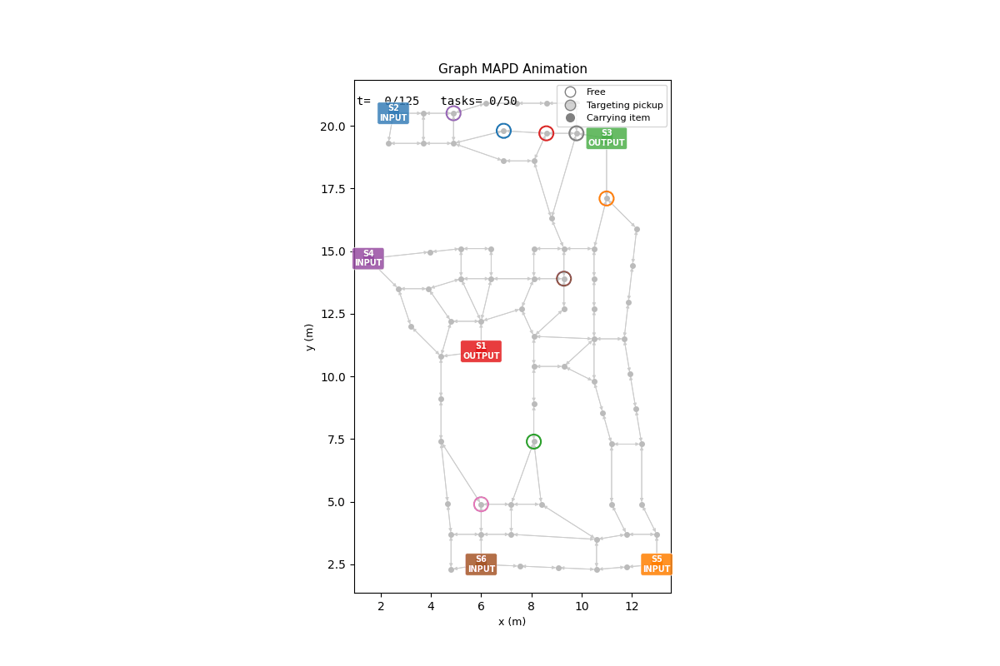

# pypibt-mapd

[](./LICENCE.txt)
[](https://www.python.org/downloads/)

A Python implementation of **Priority Inheritance with Backtracking (PIBT)** extended for three multi-agent path planning problems. This is an extended version of [pypibt](https://github.com/Kei18/pypibt) by Keisuke Okumura.

This repository combines:
- **MAPF implementation**: Unchanged from [pypibt](https://github.com/Kei18/pypibt) by Keisuke Okumura
- **MAPD implementation**: Translated from the C++ version in [pibt2](https://github.com/Kei18/pibt2) by Keisuke Okumura
- **Graph MAPD implementation**: Extended for directed graphs loaded from LIF files, with physical edge lengths and transport-matrix-driven task demand

| Problem | Description | Use when |
|---------|-------------|----------|
| **MAPF** | Find collision-free paths from fixed starts to fixed goals on a grid | One-shot path planning |
| **MAPD** | Agents continuously pick up and deliver tasks on a grid map | Warehouse automation, logistics loops |
| **Graph MAPD** | MAPD on a directed graph loaded from a LIF file, with physical edge lengths and transport-matrix-driven task demand | Industrial mobile robot fleets with real layouts |

All implementations are based on [[1]](#references).

## Background

PIBT is a powerful algorithm for moving hundreds of agents smoothly in real-time. It was originally developed not just to solve MAPF, but to keep multiple agents running efficiently in dynamic environments.

**MAPF (Multi-Agent Path Finding)**: Find collision-free paths for agents from fixed start positions to fixed goal positions. Use this when you need one-shot path planning.

**MAPD (Multi-Agent Pickup and Delivery)**: Coordinate agents to continuously pick up and deliver items. Tasks appear dynamically, and agents complete them in sequence. Use this for warehouse automation, logistics, and continuous operations.

**Graph MAPD**: Extends MAPD to arbitrary directed graphs (e.g. real mobile robots layouts from LIF files). Edge lengths are physical distances in metres, enabling realistic throughput metrics. Dead-end corridors are automatically detected and protected to prevent deadlocks.

This Python implementation makes PIBT accessible for:
- Quick prototyping and experimentation
- Integration with Python ML frameworks
- Educational purposes and algorithm understanding
- Extension to new problem domains

## Demo

**MAPF – 100 agents on a random grid**


**MAPD – 100 agents on a random grid**


**Graph MAPD – 8 agents on a directed warehouse graph**



## Setup

This repository is easily set up with [uv](https://docs.astral.sh/uv/).

```sh
git clone https://github.com/marvin-rdt/pypibt-mapd.git
cd pypibt-mapd
uv sync
```

## Usage

### MAPF (Multi-Agent Path Finding)

```sh
uv run python app.py --mode mapf -m assets/maps/random-32-32-10.map -i assets/mapf/random-32-32-10-random-1.scen -N 100 -o assets/mapf/output_mapf.txt
```

Grid maps and scenarios are from the [MAPF benchmarks](https://movingai.com/benchmarks/mapf/index.html).

### MAPD (Multi-Agent Pickup and Delivery)

```sh
uv run python app.py --mode mapd -m assets/maps/random-32-32-10.map -i assets/mapd/task-config.txt -N 100 -o assets/mapd/output_mapd.txt
```

### Graph MAPD

Agents pick up and deliver tasks on a directed graph loaded from a
[LIF](https://www.vda.de/en/topics/automation-and-robotics/vehicles/agv-master-data)
(Layout Interchange Format) JSON file. Task demand is sampled from a transport matrix.

```sh
uv run python app.py --mode graph-mapd --lif-file assets/graph-mapd/lif_example.json --transport-matrix assets/graph-mapd/transport_example.json -N 8 --task-num 50 -o assets/graph-mapd/output_graph-mapd.txt
```

Key features:
- Graph is **directed** (one-way lanes); dead-end corridors are detected and protected automatically
- Edge lengths are **physical distances** (metres); metrics include makespan, flowtime, and throughput in seconds
- Task assignment: `"global"` (shared FIFO queue) or `"per_agent"` (pre-assigned round-robin)

### Visualization

Visualize MAPF and MAPD solutions with the built-in Python visualizer:

```sh
# Animate a MAPF solution
uv run python src/pypibt/visualize_mapd.py assets/mapf/output_mapf.txt -m assets/maps/random-32-32-10.map --mode mapf

# Animate a MAPD solution and save as GIF with speed control
uv run python src/pypibt/visualize_mapd.py assets/mapd/output_mapd.txt -m assets/maps/random-32-32-10.map --mode mapd --save assets/mapd/output_mapd.gif --speed 5.0

# Fast playback without interpolation
uv run python src/pypibt/visualize_mapd.py assets/mapd/output_mapd.txt -m assets/maps/random-32-32-10.map --mode mapd --no-interpolation
```

**Features:**
- **Agent status**: Agents show loaded (filled) and unloaded (hollow) states
- **Goal lines**: Next goal locations of agents are dynamically visualized
- **Task tracking**: Timestep and completed tasks are tracked (e.g., "Timestep: 50/100 | Tasks: 25/500")
- **Speed control**: `--speed` parameter controls saved animation speed (timesteps/second)
- **Smooth motion**: 5-frame interpolation by default, disable with `--no-interpolation` for faster playback

The MAPF output format is also compatible with [mapf-visualizer](https://github.com/kei18/mapf-visualizer).

Visualize Graph MAPD solutions with the dedicated graph visualizer:

```sh
# Animate a Graph MAPD solution
uv run python src/pypibt/visualize_graph_mapd.py assets/graph-mapd/output_graph-mapd.txt --lif-file assets/graph-mapd/lif_example.json

# Save as GIF
uv run python src/pypibt/visualize_graph_mapd.py assets/graph-mapd/output_graph-mapd.txt --lif-file assets/graph-mapd/lif_example.json --save assets/graph-mapd/output_graph-mapd.gif --fps 20
```

### Jupyter Notebooks

Interactive tutorials with visualization:

```sh
uv run jupyter lab
```

Open these notebooks for step-by-step examples:

| Notebook | Content |
|----------|---------|
| `notebooks/mapf_demo.ipynb` | MAPF on random and warehouse maps with animated GIFs |
| `notebooks/mapd_demo.ipynb` | MAPD on random and warehouse maps with animated GIFs |
| `notebooks/graph_mapd_demo.ipynb` | Graph MAPD on a directed graph with transport matrix, animated GIF, and full stats |

Both MAPF and MAPD notebooks include a complete workflow from problem setup to animated visualization displayed as GIF images (no ffmpeg required).

## License

This software is released under the MIT License, see [LICENCE.txt](LICENCE.txt).

## References

[1] Okumura, K., Machida, M., Défago, X., & Tamura, Y. (2022).
*Priority Inheritance with Backtracking for Iterative Multi-Agent Path Finding.*
Artificial Intelligence, 310, 103752.
[[paper]](https://doi.org/10.1016/j.artint.2022.103752) [[project]](https://kei18.github.io/pibt2/)

```bibtex
@article{okumura2022priority,
  title={Priority Inheritance with Backtracking for Iterative Multi-agent Path Finding},
  author={Okumura, Keisuke and Machida, Manao and D{\'e}fago, Xavier and Tamura, Yasumasa},
  journal={Artificial Intelligence},
  pages={103752},
  year={2022},
  publisher={Elsevier}
}
```